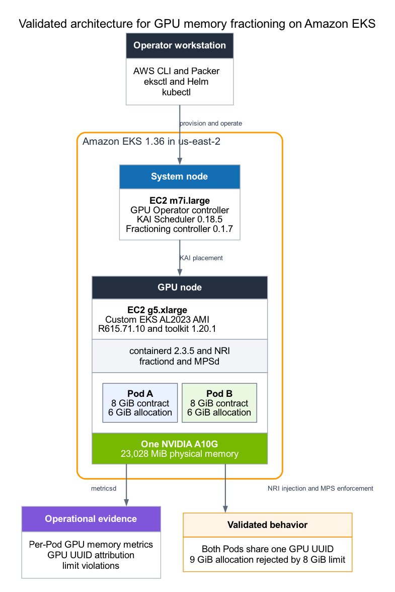

# NVIDIA Run:ai GPU Fractioning on Amazon EKS

This sample demonstrates how to place two GPU-memory-bounded Kubernetes Pods
on one NVIDIA A10G in Amazon EKS. It builds a custom EKS 1.36 Amazon Linux 2023
(AL2023) worker image with the NVIDIA R615 open driver, installs NVIDIA GPU
Operator without replacing the image-owned driver or toolkit, and deploys KAI
Scheduler with the NVIDIA Run:ai GPU Fractioning Operator.

On October 13, 2026, NVIDIA announced that the full NVIDIA Run:ai platform is
available as open-source software as part of NVIDIA DSX AI Factory. The platform
can be adopted as an integrated whole or through modular components. This sample
uses two modules, KAI Scheduler and GPU Fractioning Operator; it does not install
the complete Run:ai platform. Community software does not include NVIDIA
enterprise support.

> This sample creates billable AWS resources, including an EKS control plane, a
> NAT gateway, EC2 instances, EBS volumes, and an AMI snapshot. Run the cleanup
> step when testing is complete.

## Architecture



The disposable cluster contains one `m7i.large` system node and one On-Demand
`g5.xlarge` GPU node. The G5 node uses the custom AL2023 image and exposes one
NVIDIA A10G. Two Pods each receive an 8 GiB view of the same physical GPU and
allocate 6 GiB concurrently.

## What the sample proves

1. With the standard integer `nvidia.com/gpu` resource, one whole-GPU Pod runs
   and a second remains Pending.
2. With two 8 GiB Run:ai memory contracts, both Pods run on the same node and
   GPU UUID.
3. Each Pod successfully allocates 6 GiB within its contract.
4. A 9 GiB allocation is rejected inside an 8 GiB contract.
5. GPU fractioning metrics attribute memory consumption to each Pod.

## Prerequisites

### AWS account and credentials

Use an AWS account with sufficient quota and permissions to create and delete
EKS, CloudFormation, VPC, EC2, EBS, IAM, and related resources. The identity
also needs `ssm:GetParameter` to discover the recommended EKS AL2023 base AMI.

Configure the AWS CLI through any supported credential provider, such as:

- An AWS CLI named profile or IAM Identity Center profile
- An assumed role
- An EC2 or development-environment role
- Access key and secret access key environment credentials

Roles, IAM Identity Center, and temporary credentials are preferred. If access
keys are required, place them only in the local ignored `walkthrough.env`, set
the file permission to `600`, and never commit or share that file.

The repository's prerequisite check prints the active AWS identity before it
creates anything. A named profile and Region can be set in `walkthrough.env`
after cloning.

Confirm that the Region has `g5.xlarge` capacity and that the account has enough
EC2 On-Demand G and VT instance quota for one G5 node and the temporary Packer
builder. Capacity is not guaranteed by this sample.

### Local tools

Install the following command-line tools:

- AWS CLI v2
- `eksctl`
- `kubectl`
- Helm 3 or 4
- HashiCorp Packer
- `jq`
- `curl`

## Clone and run

The reader-facing workflow uses only two files: `walkthrough.env` for optional
configuration and `run.sh` for every action. All manifests, Helm values, Packer
files, validation probes, and cleanup logic remain versioned behind that entry
point.

```bash
git clone https://github.com/murubhas/amazon-eks-runai-gpu-fractioning.git
cd amazon-eks-runai-gpu-fractioning
cp walkthrough.env.example walkthrough.env
chmod 600 walkthrough.env
```

Edit `walkthrough.env` only when the defaults do not match your AWS environment.
Choose either a named profile or access-key variables; do not configure both.
Verify the local tools and active AWS identity before provisioning anything:

```bash
./run.sh check
```

Then either run one stage at a time, as shown below, or run the complete
validation through the negative test:

```bash
./run.sh walkthrough
```

The wrapper never performs cleanup automatically, so the evidence remains
available for inspection. Run `./run.sh cleanup` when validation is complete.

## Configure the walkthrough

The checked-in `walkthrough.env.example` contains these defaults:

```bash
AWS_REGION=us-east-2
CLUSTER_NAME=runai-fractioning-blog
EKS_VERSION=1.36
GPU_INSTANCE_TYPE=g5.xlarge
NVIDIA_DRIVER_VERSION=615.71.10

# Authentication option 1: named profile
# AWS_PROFILE=my-profile

# Authentication option 2: access keys
# AWS_ACCESS_KEY_ID=YOUR_ACCESS_KEY_ID
# AWS_SECRET_ACCESS_KEY=YOUR_SECRET_ACCESS_KEY
# AWS_SESSION_TOKEN=YOUR_SESSION_TOKEN
```

`AWS_SESSION_TOKEN` is needed only for temporary credentials. When none of the
credential variables is set, the AWS CLI and Packer use their normal credential
provider chains. `run.sh` exports the selected configuration to every stage.
Generated kubeconfig, AMI IDs, rendered eksctl files, and logs are written to
the ignored `.state` directory.

## Step 1 Create the disposable EKS cluster

```bash
./run.sh create-cluster
```

The command creates a dedicated VPC, an EKS 1.36 control plane, and one private
`m7i.large` managed node. The cluster is intentionally separate from existing
development and production clusters.

## Step 2 Build the custom AL2023 R615 image

```bash
./run.sh build-ami
```

The script performs these actions:

1. Finds a public subnet in the disposable cluster VPC for the temporary Packer
   builder.
2. Retrieves the current recommended EKS 1.36 AL2023 x86 standard AMI from the
   AWS Systems Manager public parameter.
3. Installs the NVIDIA R615 open-driver stream and NVIDIA Container Toolkit.
4. Configures NVIDIA as the default containerd runtime and verifies DKMS and RPM
   state.
5. Creates an encrypted custom AMI and records its ID in `.state/ami-id`.

Set `SOURCE_AMI_ID` or `PACKER_SUBNET_ID` before running the command when you
need to pin a previously approved base image or use a different builder subnet.

## Step 3 Add one G5 worker

```bash
./run.sh add-gpu-node
```

The node group stays at exactly one On-Demand `g5.xlarge`. It is tainted so
ordinary workloads do not consume the GPU. The script prevents eksctl from
installing a separate NVIDIA device plugin because GPU Operator owns that
component.

## Step 4 Install GPU Operator and inspect the host stack

```bash
./run.sh install-gpu-operator
```

The values file deliberately sets `driver.enabled=false` and
`toolkit.enabled=false`. The custom AMI owns the host driver and toolkit; GPU
Operator supplies the remaining Kubernetes GPU components, including the
device plugin.

The script runs a short-lived privileged inspection Pod in this disposable
environment. It reports the GPU model and memory, driver, toolkit, containerd,
cgroup filesystem, and NRI socket, and then removes itself.

## Step 5 Establish the whole-GPU baseline

```bash
./run.sh baseline
```

Expected result: one Pod is Running and one is Pending because the default
extended GPU resource is indivisible. The script records the state and removes
both baseline Pods.

## Step 6 Install KAI Scheduler and GPU Fractioning

```bash
./run.sh install-kai
```

The command installs the official pinned OCI chart:

```text
oci://ghcr.io/kai-scheduler/kai-scheduler/kai-scheduler:v0.18.5
```

The chart includes GPU Fractioning Operator `v0.1.7`. The script waits for the
default fractioning configuration and the G5 node's fractioning readiness
condition.

## Step 7 Run the positive sharing test

```bash
./run.sh share
```

The test creates two Pods with identical 8 GiB request and limit annotations.
Neither requests a whole `nvidia.com/gpu`. Each compiles a small CUDA program,
allocates 6 GiB, and holds the allocation so both Pods can be observed together.
The script verifies that both Pods use the same node and GPU UUID.

Expected placement:

```text
NAME             READY   STATUS    NODE
fraction-8gi-a   1/1     Running   <same-gpu-node>
fraction-8gi-b   1/1     Running   <same-gpu-node>
```

## Step 8 Observe per-Pod GPU memory

Run this command while the two positive-test Pods are still active:

```bash
./run.sh metrics
```

Expected output includes one `gpu_fractioning_gpu_memory_used_bytes` series for
each test Pod.

## Step 9 Prove the memory limit

```bash
./run.sh limit
```

The script replaces the positive-test Pods with one Pod that has the same 8 GiB
contract but attempts to allocate 9 GiB. The CUDA allocation must fail with
`out of memory`; the Pod exits successfully because rejection is the expected
test result.

Expected Pod status:

```text
NAME                      READY   STATUS      NODE
fraction-8gi-over-limit   0/1     Completed   <gpu-node>
```

`Completed` is expected: the probe exits with code 0 only after confirming that
CUDA rejected the oversized allocation.

## Step 10 Clean up

```bash
./run.sh cleanup
```

Cleanup removes the test namespace, Helm releases, managed nodes, EKS control
plane, CloudFormation stacks, and disposable VPC. Before deletion, the script
requires the ownership tags created by this sample. It preserves the reusable
AMI and its EBS snapshot by default.

Delete the image only after confirming that it is not needed elsewhere:

```bash
./run.sh cleanup-all
```

## Validated component set

This implementation was validated on October 15, 2026 with:

| Component | Validated version |
| --- | --- |
| Amazon EKS | 1.36 |
| EC2 GPU instance | `g5.xlarge`, NVIDIA A10G 23028 MiB |
| Amazon Linux | EKS-optimized AL2023 standard base image |
| NVIDIA driver | 615.71.10 open kernel modules |
| NVIDIA Container Toolkit | 1.20.1-1 |
| containerd | 2.3.5 |
| NVIDIA GPU Operator | 26.7.1 |
| NVIDIA device plugin | 0.20.1 |
| KAI Scheduler | 0.18.5 |
| GPU Fractioning Operator | 0.1.7 |

See [validated results](docs/VALIDATED-RESULTS.md) for the measured acceptance
evidence.

The NVIDIA driver version tracks the current point release of the R615 open
kernel-module stream in NVIDIA's CUDA repository. The October 15, 2026 run
observed 615.71.09; the stack was re-validated on 615.71.10 after the stream
advanced, with identical results. The build installs whatever point release
the 615-open stream currently serves, so expect this value to move forward
over time.

## Production considerations

- GPU memory fractioning is not a hard multi-tenant security boundary. Use
  whole-GPU allocation or NVIDIA MIG on supported devices when stronger fault,
  security, or performance isolation is required.
- Size contracts from measured peak memory and retain headroom for CUDA
  contexts, kernels, caches, batching, the driver, and the runtime.
- Measure latency and throughput under concurrent load. A memory fit does not
  guarantee acceptable compute performance.
- Pin and govern the EKS base image, driver, toolkit, GPU Operator, KAI chart,
  workload images, and their digests as one tested compatibility set.
- Rebuild custom images from approved bases rather than upgrading GPU packages
  in place on long-lived nodes.
- Apply least-privilege IAM, admission policies, trusted-image controls,
  namespace isolation, network policies, monitoring, and automated cleanup.

## Repository layout

```text
ami/          Packer template and R615 installation script
config/       eksctl templates rendered into the ignored .state directory
docs/         Architecture and point-in-time validation evidence
helm/         GPU Operator and KAI values
kubernetes/   Namespaces, host inspection, and acceptance-test workloads
scripts/      Ordered create, validate, observe, and cleanup commands
run.sh        Single reader-facing command entry point
walkthrough.env.example  Optional configuration template
```

## References

- [NVIDIA Run:ai open-source announcement](https://developer.nvidia.com/blog/nvidia-runai-is-now-open-source-as-part-of-nvidia-dsx-ai-factory-platform/)
- [KAI Scheduler](https://github.com/kai-scheduler/KAI-Scheduler)
- [GPU Fractioning Operator](https://github.com/kai-scheduler/gpu-fractioning)
- [Amazon EKS optimized accelerated AMIs](https://docs.aws.amazon.com/eks/latest/userguide/ml-eks-optimized-ami.html)
- [Retrieve recommended Amazon EKS AMI IDs](https://docs.aws.amazon.com/eks/latest/userguide/retrieve-ami-id.html)

## License

This project is licensed under the MIT License. See [LICENSE](LICENSE).
